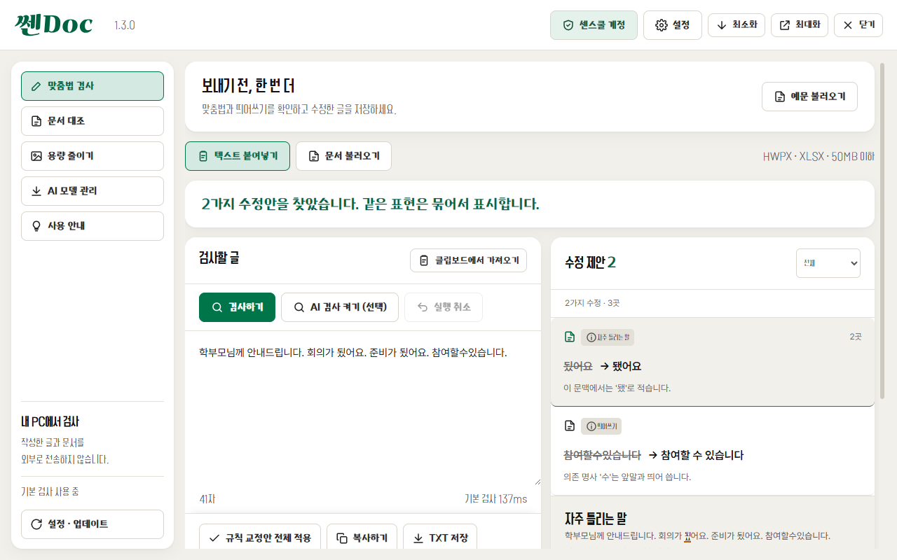
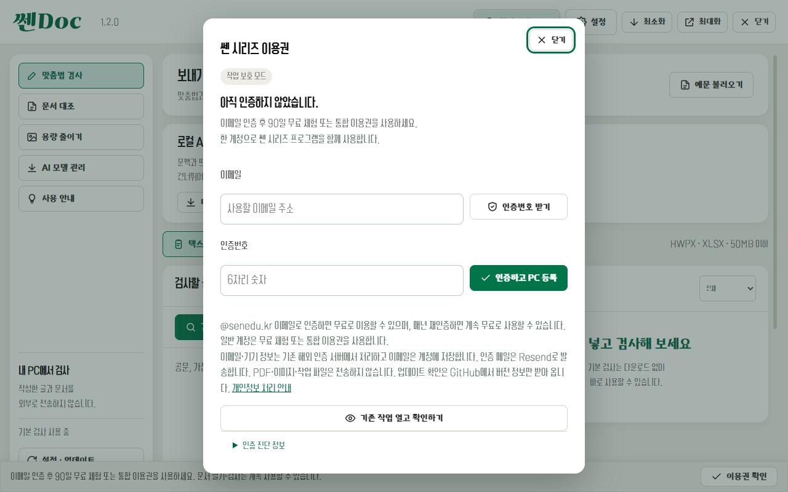
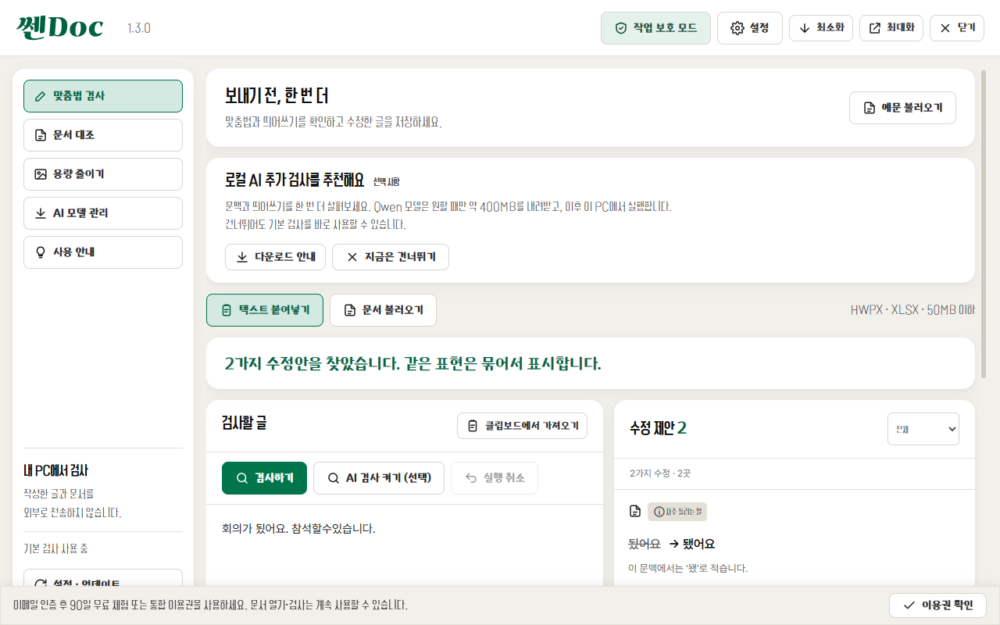

# 쎈Doc

선생님의 문서 작업을 위한 Windows 앱입니다. 쎈Pick의 문서 대조, 쎈Lite의 HWPX 용량 줄이기, 맞춤법·띄어쓰기 검사를 하나의 실행 파일에서 사용합니다.

최신 공개 버전은 [1.5.2](https://github.com/HooniKims/ssen-doc/releases/tag/v1.5.2)입니다. 1.4.0~1.5.1에서 준비한 공문 항목 정리·표·자동 번호·AI 구조 검토를 함께 제공합니다. [공문 항목 정리 사용법](docs/RELEASE-NOTES-1.5.2.md#공문-항목-정리-사용법)을 참고하세요.

1.5.2는 실제 예문 시험에서 드러난 어미·의존 명사 띄어쓰기·일부 문장 호응 누락을 보완합니다. 인용문·코드·주소를 보호하고, 겹치는 맞춤법·띄어쓰기 교정을 함께 반영하며, 반복된 표현의 위치를 구분합니다. 명확한 규칙은 규칙 결과로 표시하고 문맥에 따라 달라지는 제안은 개별 확인 후 적용합니다. [고정 평가 기준](docs/QUALITY95-PROTOCOL.md)과 [검증 결과](docs/RELEASE-1.5.2.md)를 참고하세요.

1.5.1은 실제 예문 시험에서 드러난 AI 응답 누락을 보완합니다. 모델은 짧은 수정안 또는 문맥 후보만 선택하고, 근거 표시는 코드가 검증합니다. 날짜·소수·이메일을 보존하며 잘못된 응답은 한 번 재시도합니다. `바람니다`는 기본 규칙으로 고치고, `안/않`, 자격을 나타내는 `로서`, 경과 시간의 `지`와 일부 문장 호응은 문맥 검토 제안으로 제공합니다. AI 제안은 사용자가 확인하여 적용합니다. 로컬 설치 파일은 `release/1.5.1/`에 있으며 공개 릴리즈와 구분합니다.

1.5.0에는 **공문 항목 정리의 로컬 AI 구조 검토**와 **HWPX 표·자동 번호 처리**를 추가했습니다. **공문 항목 정리 → AI 구조 검토(선택) → 선택한 제안을 미리보기에 반영 → 변경 사항 적용 → 교정본 저장** 순서로 사용합니다. 명확한 번호 정리는 모델 없이 동작하고, 애매한 단계만 로컬 모델에 물어봅니다. AI는 본문을 다시 쓰지 않습니다. 표는 셀마다 목록을 분리하고, 한글의 문단 번호는 자동 번호 기능을 유지합니다. 적용 후 **항목 정리 되돌리기**로 복원할 수 있습니다. 개요·글머리표 설정, 중첩 표·필드 등은 제외합니다. 자세한 범위는 [1.5.0 변경 내역](docs/RELEASE-1.5.0.md)을 확인하세요. 새 설치 파일은 로컬 `release/1.5.0-ready/`에 준비하며 공개 릴리즈와 구분합니다.

## 사용하기

Windows 10/11 x64에서 [최신 릴리즈](https://github.com/HooniKims/ssen-doc/releases/latest)의 설치형 `SsenDoc-Setup-1.5.2.exe`를 실행하거나, `SsenDoc-1.5.2-x64.zip`을 **모두 풀고** `SsenDoc.exe`를 실행하세요. ZIP의 실행 파일만 옮기면 동작하지 않습니다. 코드 서명 인증서가 없어 SmartScreen 경고가 나타날 수 있습니다. 배포 출처와 SHA-256을 확인하고 신뢰하는 파일만 실행하세요.

1.3.0은 불필요한 검사 제안을 줄이고 규정 근거 보기·로컬 RAG·일부 문장 호응 검사를 추가했습니다. 정상 표현은 그대로 두고 같은 수정안을 묶어 표시합니다. [변경 내용](docs/RELEASE-1.3.0.md)을 확인하세요.

1.2.0은 쎈 시리즈 디자인 가이드를 적용한 버전입니다. 세 기능의 색상·글꼴·버튼·설정 창과 로고를 통일했습니다. 기본 창은 1280×800, 최소 창은 1024×700입니다. [적용 내용과 화면](docs/DESIGN-UNIFICATION.md)을 확인하세요.



1.1.0부터 **교정 적용·저장·복사·압축 저장·모델 변경은 공통 인증 후 사용**합니다. 문서 열기와 검사, 붙여 넣은 글의 검사는 인증 없이 가능합니다.

쎈 시리즈 공통 계정으로 로그인합니다. 센스쿨(@senedu.kr) 이메일이면 무료입니다. 이미 다른 쎈 앱에서 인증했다면 따로 할 일이 없습니다.

화면 오른쪽 위 이용권 버튼에서 이메일 인증번호 로그인, 90일 무료 체험, 통합 이용권 코드 등록, 등록 PC 관리와 교육용 계정의 연간 재인증을 진행합니다. 로그인·이용권 갱신에는 인터넷이 필요하며, 오프라인 편집 가능 여부는 저장된 이용권의 유효기간에 따릅니다. 검사 엔진은 계속 로컬에서 작동합니다. 공통 계정에서 로그아웃하거나 PC 등록을 해제하면 다른 쎈 앱에도 다음 확인 때 반영됩니다.




- **맞춤법 검사:** 글을 붙여 넣고 검사 → 항목 확인 → 적용 → 복사 또는 TXT/HTML 저장. 기존 규칙 중 문맥 안내와 불확실한 치환은 기본 결과에서 제외합니다. 사전 미등록어와 글자 유사도 후보도 표시하지 않습니다. 반복 수정은 묶어서 표시하고 각 위치를 확인할 수 있습니다.
- **문서 교정:** HWPX 또는 XLSX(50MB 이하)를 불러오면 문단·셀별로 같은 검사 기준을 적용합니다. 직접 수정하거나 교정 후보를 적용한 뒤 **교정본 저장**을 누르세요. 원본을 덮어쓰지 않습니다.
- **문서 대조:** 기준 문서와 대상 문서를 대조하고 차이를 확인합니다. 기존 쎈Pick의 검토·수정본 저장 기능을 포함합니다.
- **용량 줄이기:** 기존 쎈Lite의 HWPX 이미지 압축·목표 용량 기능을 사용합니다.

자동 검사가 모든 오류를 잡아내지는 못합니다. 올리기 전 한 번 더 읽어보세요.

## 선택형 로컬 AI

AI 맞춤법 검사는 최초 1회 모델 다운로드(약 400MB)가 필요합니다. 규칙 기반 검사는 다운로드 없이 바로 사용 가능합니다.

첫 화면에서 로컬 AI를 **선택 사항으로 추천**합니다. **다운로드 안내**, **AI 검사 켜기 (선택)** 또는 AI 모델 관리를 눌러 안내를 확인한 다음, **AI 모델 다운로드**를 직접 선택해야 받습니다. 앱 실행·기본 검사만으로는 모델을 받지 않습니다. **지금은 건너뛰기**를 누르면 다음 실행부터 추천을 숨기고 기본 검사를 계속 사용할 수 있습니다. 나중에 AI 모델 관리에서 다운로드·일시정지·재개·재시도·삭제·GGUF 파일 직접 지정을 할 수 있습니다. 모델 자체는 무료이며 선택 사항입니다. 다운로드·직접 지정·삭제에는 앱 이용권이 필요합니다. 이미 설치한 모델의 추가 검사는 인증 없이도 가능합니다. 다운로드한 파일은 SHA-256으로 검증합니다. 앱 데이터 폴더의 `models/`에 저장되며, 직접 지정한 파일도 복사해서 사용합니다. 모델 삭제 시 직접 지정한 원본 파일은 보존합니다.

기본 모델은 Qwen3 0.6B Q4_K_M(396,705,472바이트, Apache-2.0)입니다. CPU로 실행하며, AI 결과는 사용자가 항목별로 적용해야 합니다. 앱에서 제공하는 AI 모델은 Qwen 한 가지입니다. 모델은 설치 파일에 포함하지 않습니다.

로컬 검색 근거는 `src/knowledge/korean-rules.json`에 있는 공식 자료의 자체 요약 5건입니다. 한글 맞춤법 제35·42·53항, 허용 표기를 보호하기 위한 제47항 참고 자료, 문장 호응 참고 자료를 선별했습니다. 규정 전문을 탑재한 것은 아닙니다. 관련 표현으로 최대 3건을 검색하고 예외·예문·주변 문맥을 모델에 전달합니다. 관련 규정이 없어도 모든 문장 구간을 실제 모델로 검사합니다. 규정 요약 밖의 오류는 AI의 별도 재검토를 통과한 경우에만 ‘AI 검토’로 표시하고 공식 규정 근거와 구분합니다. 허용 표기·문체 변경·숫자 변경 등은 제외합니다. 근거를 찾았다는 사실만으로 오류를 생성하지 않습니다. 자료별 출처·확인일·버전은 결과의 **근거 보기**에서 확인할 수 있습니다.

일부 명확한 문장 호응 패턴(예: ‘저의 목표는 학생들이 안전하게 귀가합니다.’)은 별도 구조 규칙으로 검사합니다. 이 결과는 **문장 호응**으로 분리하며 전체 적용 대상에서 제외합니다. ‘이 표현 무시’는 현재 글/문단의 재검사에도 유지되고, 다른 글/문단을 불러오면 초기화됩니다. 정상 문장 오탐·오류 교정을 `npm run test:quality`로 평가하며, 설치된 모델까지 확인하려면 `npm run test:quality -- --ai`를 실행합니다. 평가 결과는 `_workspace/spelling-quality.json`에 저장하며 모델을 자동 다운로드하지 않습니다.

검사할 글과 문서를 외부 서버로 전송하지 않습니다. 렌더러의 HTTP·HTTPS·WebSocket 요청을 차단합니다. main 프로세스에서 공통 인증·이용권 확인, 모델 다운로드와 GitHub 업데이트를 별도 처리합니다. 인증 정보의 처리는 [개인정보 처리 안내](https://ssenbox.lovable.app/privacy)를 참고하세요. 외부 맞춤법 API, 원격 AI, 텔레메트리는 사용하지 않습니다.

## 지원 범위와 한계

- 기본 검사는 등록된 규칙을 찾습니다. 모든 어휘·문맥·띄어쓰기를 판정하는 문법 분석기는 아닙니다. `왠지`, `이쁘다`, `반듯이`, `대게`처럼 맞는 표현을 무조건 바꾸지 않습니다.
- 빈도 사전은 표준어 판정 근거로 사용하지 않습니다. 기존 자료와 모듈은 보존하지만 기본 검사·AI 병합 결과에 미등록어 추천을 넣지 않습니다. 출처·라이선스: [WORDLIST-NOTICE](assets/WORDLIST-NOTICE.txt).
- AI도 오류를 놓치거나 잘못 제안할 수 있습니다. 현재 0.6B 모델은 근거를 제공해도 호응 오류를 놓칠 수 있어 일부 구조 규칙을 함께 사용합니다. 모든 비문을 검사하는 기능은 아닙니다. 문장 구간당 재검토를 포함해 최대 30초이며 시간 초과는 실패로 표시합니다. 문서 모드의 ‘문서 전체 AI 검사’는 모든 문단·셀을 대상으로 하고 텍스트 모드에서는 글 전체를 검사합니다. 실제 검사·실패·미검사 구간 수를 표시하며 중단 시 완료한 결과를 보존합니다. 긴 문장은 240자 이내로 나눕니다. 수정한 문단은 다시 검사해야 합니다. 규칙 검사 3초 목표는 짧은 일반 문서를 기준으로 하며 AI 시간은 포함하지 않습니다.
- HWPX의 복잡한 필드·수식·개체가 있는 문단, XLSX의 수식·보호된 셀 등은 읽기 전용입니다. 구형 HWP/XLS, DOCX, PDF, 이미지 OCR은 지원하지 않습니다. 한 번에 최대 100개 문단·셀의 수정본을 저장합니다.
- 문서 구조와 서식을 보존하며 지원하는 텍스트만 수정합니다. 한글/Excel에서 교정본을 열어 페이지 배치와 수식을 최종 확인하세요. PDF처럼 인쇄된 페이지 위에 밑줄을 표시하는 방식이 아니라 문단·셀 목록에서 위치와 내용을 표시합니다.
- 기본 검사 입력은 100,000자 이하입니다.
- 임의의 GGUF 모델은 파일 헤더와 복사 무결성을 확인하지만 모든 아키텍처·채팅 템플릿의 호환성을 보장하지 않습니다.
- GitHub 업데이트 경로는 `HooniKims/ssen-doc`입니다. 설치형은 앱에서 업데이트를 확인할 수 있으며 ZIP은 새 버전을 내려받아 교체합니다.

## 개발·테스트·빌드

Node.js 24 이상과 Windows x64를 사용합니다.

```powershell
npm ci
npm start
npm test
npm run test:ui
npm run test:ai
node scripts/test-model-lifecycle.cjs
npm run dist
node scripts/test-model-lifecycle.cjs --packaged
```

`test:ai`와 모델 관리 통합 테스트는 실제 모델을 다운로드하므로 인터넷·약 1GB 이상의 여유 공간이 필요합니다. 일반 단위/UI 테스트는 모델 없이 실행합니다. Rust 압축 엔진을 새로 빌드하려면 Rust MSVC 도구 체인이 필요합니다. 로컬 개발용으로 가져온 엔진이 있으면 재사용하고, 없으면 Cargo로 빌드합니다.

검증 기록: [UPDATE-VERIFICATION](docs/UPDATE-VERIFICATION.md), 배포: [RELEASING](RELEASING.md). `release/`, `node_modules/`, 모델과 테스트 작업 폴더는 Git에서 제외합니다.

## 저작권과 이용약관

© 2026 상명초 김승현, 등촌중 김형훈. All rights reserved.

쎈doc은 저작권법의 보호를 받는 프로그램입니다. 1.0.2부터 **쎈doc 이용약관**([LICENSE](LICENSE))이 적용됩니다. 설치 화면과 프로그램의 **설정 · 업데이트** 창에 있는 [이용약관 보기]에서도 볼 수 있습니다.
- 설치 파일은 이 페이지에서만 받아 주세요. 다른 곳(웹하드, 메신저 단체방, 다른 저장소 등)에 다시 올리지 말고, 이 주소를 안내해 주세요.
- 허락 없이 수정·개작하거나, 설치 파일·프로그램 파일을 AI 서비스에 올려 분석하게 하거나 비슷한 프로그램을 만들게 할 수 없습니다.
- 함께 들어 있는 오픈소스 구성 요소는 각자의 라이선스를 따릅니다([THIRD-PARTY-NOTICES](THIRD-PARTY-NOTICES.md)).
