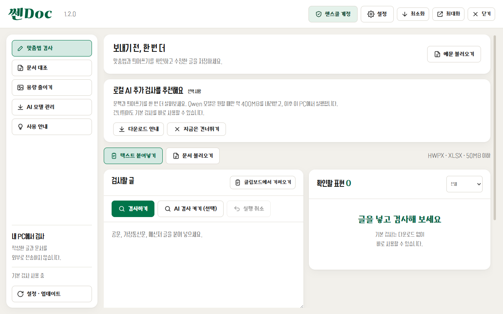
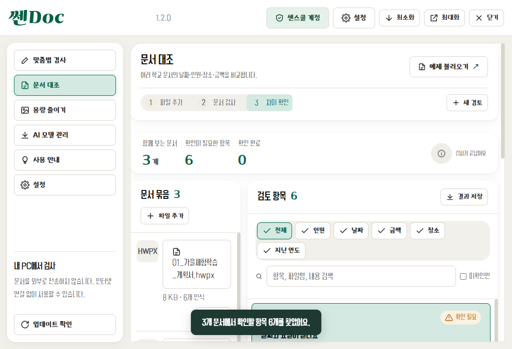
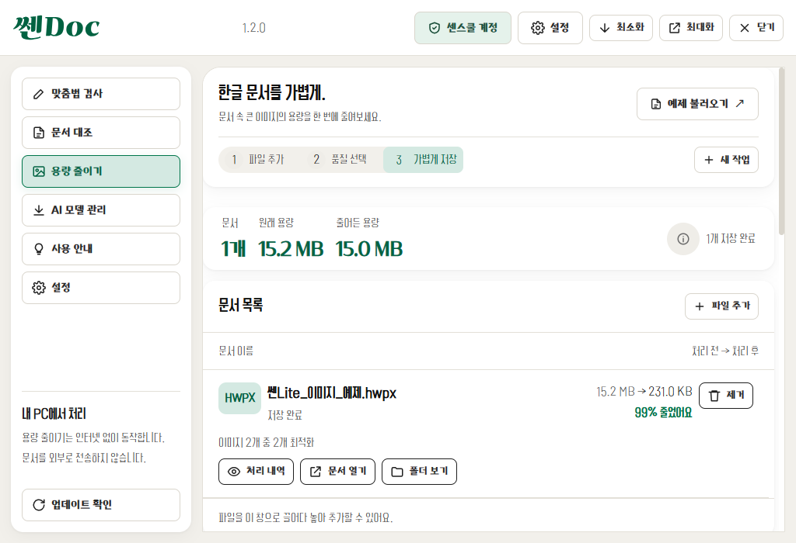
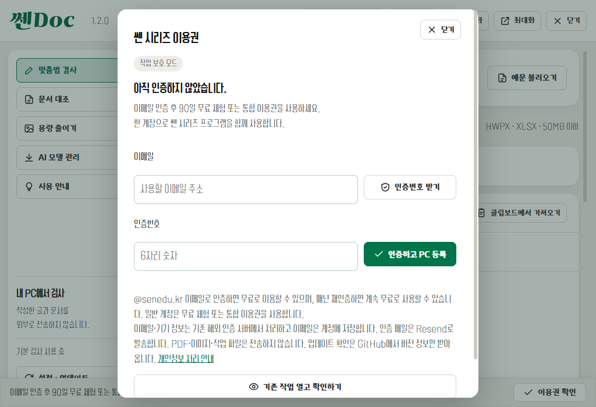

# 쎈Doc 1.2.0 디자인 통일

기준: 사용자가 제공한 `쎈시리즈_디자인통일_가이드.md` v1.0, 쎈Clean 2.0 화면 규격.
적용일: 2026-10-12.

기존 맞춤법·문서 대조·용량 줄이기의 서로 다른 헤더, 글꼴, 색상, 버튼을 공통 규격으로 맞췄다. 세 화면의 메뉴 순서, 문구의 뜻, 검사·편집·압축·인증·모델 처리 경로는 유지했다. `sen-base.css`는 가이드의 공통 CSS이며 `sen-theme.css`가 기존 화면 구조에 적용한다. `sen-ui.mjs`는 기존 버튼과 명령 연결을 유지하면서 헤더·아이콘·알림을 통일한다.

| 가이드 항목 | 적용 내용 |
|---|---|
| 색 | 크림색 #F2F0EB, 흰 카드, 초록 #00754A, 민트 #D4E9E2와 공통 상태색. |
| 본문·제목 | Cafe24 PRO Slim Air 300 / Max 700. 제공 파일의 실제 이름이 Max여서 가이드의 Bold 역할로 등록. |
| 메뉴·버튼 | 학교안심 자연 Regular, 글자 테두리 0.5px, 18px 선 아이콘과 글자. |
| 글꼴 배포 | 세 글꼴과 OFL 고지 포함. CDN 없음. 가나초콜릿체는 SVG 윤곽선 로고로만 사용하고 TTF는 패키지에서 제외. |
| 뼈대 | 72px 헤더, 34px 로고, 버전·이용권·설정, 232px 흰 사이드 카드. 기본 1280×800, 최소 1024×700. |
| 작업 영역 | 가이드 5절의 편집기 예외에 따라 문단·셀 편집은 유지. 검사 버튼을 입력란 위에 배치. 작은 창에서는 작업 카드가 세로로 이어짐. |
| 버튼·카드 | 기본 높이 42px, 작은 버튼 34px, 모서리 8px. 카드·대화상자 16px와 옅은 그림자. 파일명·교정 항목 등 여러 줄 콘텐츠 버튼만 자동 높이. |
| 상태·결과 | 대조·압축 결과 카드를 상세 목록보다 위에 배치. 결과 숫자 학교안심 자연. 상태 태그에 아이콘·문구·색 함께 표시. |
| 대화상자·알림 | 창 내부 스크롤, Escape 닫기, 기존 취소/확인 동작 유지. 하단 중앙 알림 2.5초. 인증 키트 원본은 그대로 두고 외부 CSS로 맞춤. |
| 로고·아이콘·설치 | 쎈Doc 표기, 윤곽선 SVG 로고, 문서·체크 아이콘, ICO 16/24/32/48/64/128/256px. 작은 아이콘은 반짝임 생략. NSIS 안내 그림·바로가기 이름 통일. |
| 업데이트 호환 | appId와 SsenDoc.exe 유지. 기존 `AppData/쎈doc` 경로를 명시해 모델·설정 저장 위치 유지. |

`tests/ui/design.spec.cjs`는 두 창 크기의 세 화면과 설정 창, 글꼴 로딩, 버튼 라벨·아이콘·모서리, 가로 넘침을 검사한다. 최소 창에서 실제 맞춤법 검사·문서 대조·이미지 압축 후 화면 및 인증 대화상자·보호 막대도 확인한다. 공통 인증의 여섯 원본 파일은 변경하지 않았다.

캡처는 별도 테스트 프로필·합성 문서·모의 이용권을 사용한다. 실제 계정 정보나 업무 문서를 포함하지 않는다.

검증 수치·설치 및 배포 결과는 [UPDATE-VERIFICATION](UPDATE-VERIFICATION.md)에 기록한다. 고해상도 배율별·보조 모니터별 전체 조합은 이번 자동 테스트 범위에 포함하지 않는다.
