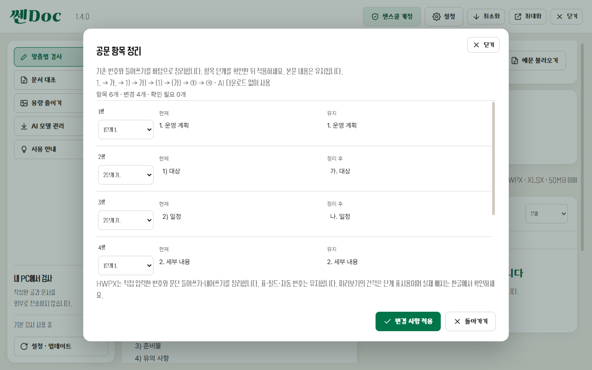

# 쎈Doc 1.4.0 — 공문 항목 정리

텍스트 또는 HWPX를 불러온 뒤 **공문 항목 정리**를 누릅니다. 변경 전후를 비교하고 항목 단계를 조정한 다음 **변경 사항 적용**을 누르세요. 텍스트는 복사·TXT/HTML 저장, HWPX는 **교정본 저장**으로 내보냅니다. 적용·복사·저장은 기존 공통 인증 정책을 따릅니다.

- 번호 체계: `1. → 가. → 1) → 가) → (1) → (가) → ① → ㉮`.
- 기존 번호와 들여쓰기로 계층을 판단합니다. 상위 항목이 없거나 들여쓰기 단계가 불명확하면 사용자가 단계를 선택해야 합니다. `유지`한 항목을 지나서는 목록을 새로 판단하므로 이후 항목도 확인이 필요할 수 있습니다.
- 같은 단계 번호를 순서대로 정리하고, 상위 항목이 바뀌면 하위 번호를 다시 시작합니다. 날짜·소수·본문 내용은 유지합니다. 본문 전체를 AI에 다시 쓰게 하지 않으며 모델 다운로드가 필요하지 않습니다.
- HWPX는 직접 입력한 번호를 정리하고 글자 크기를 기준으로 문단 들여쓰기와 내어쓰기를 설정합니다. 기존 글꼴·글자 서식·이미지·다른 문단은 보존합니다. 공유 문단 서식은 수정하지 않고 필요한 서식을 복제합니다. 줄 배치 캐시는 수정 문단에서만 지웁니다.
- **항목 정리 되돌리기**는 적용 직전 상태를 복원합니다. 적용 뒤 추가 편집을 했다면 그 편집을 먼저 되돌려야 합니다.

표 안의 항목, 필드·복잡한 개체가 있는 문단, 한글 자동 번호·개요·글머리표, 지원하지 않는 서식 단위는 제외하며 이유를 표시합니다. XLSX는 지원하지 않습니다. 저장은 한 번에 100개 문단까지입니다. 항목이 하나뿐인 목록의 기호 제거, 임의 기호 목록의 AI 계층 추론, 공문 전체 작성 규정 검사는 포함하지 않습니다.

미리보기 간격은 단계 표시용입니다. 최종 줄바꿈과 정렬은 교정본을 한글에서 열어 확인하세요. 글꼴의 실제 문자 폭에 따라 기호 뒤 정렬이 다를 수 있습니다.

항목 기호와 들여쓰기 기준: [정부 공문서 작성 안내](https://www.korea.kr/news/cardnewsView.do?newsId=148902531). 규칙 기반 구현이며 기관별 예외 규정을 모두 판정하는 기능은 아닙니다.
